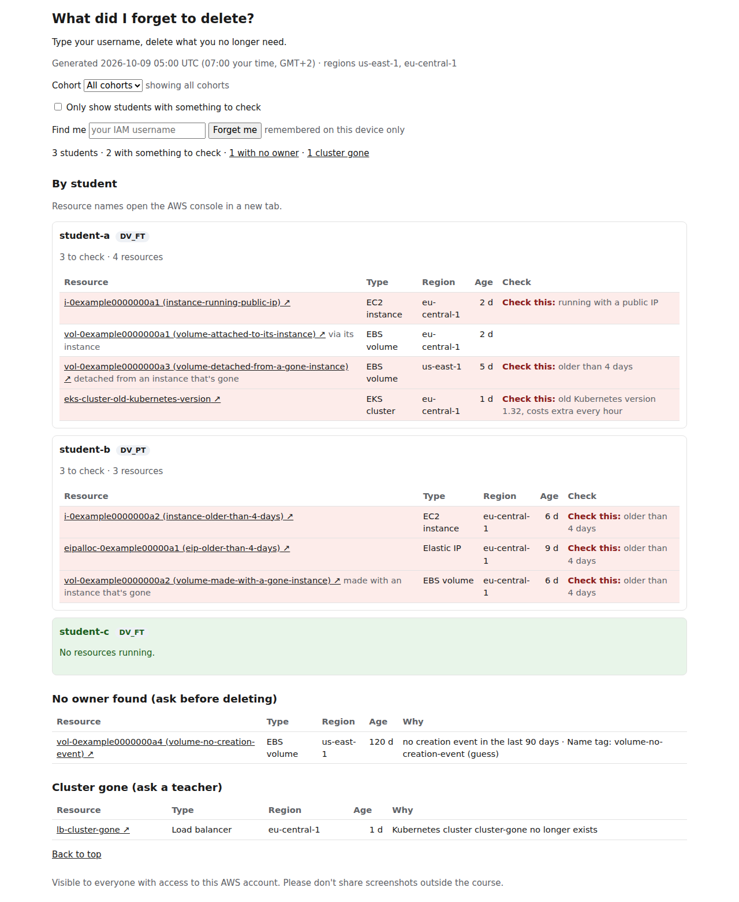

# AWS resource owner dashboard

A page, rebuilt twice a day, for everyone in a shared AWS course account, mostly students: **what did I
forget to delete?** Type your username, delete what you no longer need. Each student has a
card with their resources: name or ID (a link that opens the AWS console in a new tab), type,
region and age. A **Check this** mark, on a tinted row, sits on anything older than 4 days, on a
running instance with a public IP, and on an EKS cluster whose Kubernetes version is past
standard support (AWS charges more per hour for it). Volumes attached to an instance are never
marked; the instance's mark covers them. Teachers use the same page to see who to talk to.
Students see each other's resources (the teachers agreed). Type your username into **Find me**
to see only your own; the page remembers it on your device until you press **Forget me**. A red
banner warns when the page is more than 26 hours old.



## What's in the repo

How the dashboard works, step by step, and what each part of the page means:
[docs/FAQ.md](docs/FAQ.md).

- `src/dashboard/`: the Python code that scans, finds owners and cohorts, and renders the page.
  The same code runs as a local CLI (`python -m dashboard`) and as the Lambda.
- `infra/bootstrap/`: the account-level Terraform (the "bootstrap" stack), applied first and
  again when cohorts or regions change: the bucket that holds Terraform's state and the
  MFA-protected read-only dev role (`resource-owner-dashboard-dev`) for local scans.
- `infra/app/`: Terraform for the running dashboard (the "app" stack): the private report
  bucket, the Lambda, its schedule and the alarms.
- `infra/policies/`: the read-only policy that both stacks attach.
- `settings.json`: the regions, the 4-day age limit and the CloudTrail lookback, read by the CLI
  and both stacks. Cohort group names stay in gitignored files only.
- `scripts/`: build the Lambda bundle, run it locally before a deploy
  (`scripts/local_lambda_run.py`), the smoke test, and masked Terraform summaries.
- `tests/`: pytest, no AWS access needed.

## Run it locally

The demo needs only Python 3.14:

```bash
python3.14 -m venv .venv && . .venv/bin/activate
pip install -e '.[dev]' && pre-commit install
python -m dashboard demo    # fake data, no AWS: writes out-demo/index.html
```

To scan the real account you also need Terraform 1.16, AWS CLI v2 (2.32 or later for
`aws login`) and an IAM user with MFA in the course account:

```bash
cp dashboard.example.toml dashboard.toml   # cohort groups and roster path only, never commit
```

Bootstrap (state bucket + MFA-protected read-only role). Pick the variant that matches your account:

- **Existing account (stack already applied):** fill in the bucket name in `backend.hcl`, never commit it.
  ```bash
  cd infra/bootstrap && cp backend.hcl.example backend.hcl
  terraform init -backend-config=backend.hcl
  cd ../..
  ```
- **First bootstrap in a new account (an admin):**
  ```bash
  cd infra/bootstrap && cp terraform.tfvars.example terraform.tfvars  # fill in, never commit
  # comment out the `backend "s3" {}` block in backend.tf, then:
  terraform init && terraform apply
  cp backend.hcl.example backend.hcl   # put `terraform output -raw state_bucket` in it, never commit
  # restore the `backend "s3" {}` block in backend.tf, then:
  terraform init -migrate-state -backend-config=backend.hcl
  rm -f terraform.tfstate terraform.tfstate.backup
  cd ../..
  ```

Create the `dashboard-dev` profile that assumes the role. Pick the variant that matches your MFA:

- **Passkey (`aws login`):** replace `<login profile>` with the profile you sign in with.
  ```bash
  aws configure set profile.dashboard-dev.role_arn "$(terraform -chdir=infra/bootstrap output -raw dev_role_arn)"
  aws configure set profile.dashboard-dev.source_profile <login profile>
  aws configure set profile.dashboard-dev.region us-east-1
  ```
- **Authenticator app (TOTP):** replace `<your profile>` with your IAM user's profile and
  `<device>` with your MFA device name.
  ```bash
  aws configure set profile.dashboard-dev.role_arn "$(terraform -chdir=infra/bootstrap output -raw dev_role_arn)"
  aws configure set profile.dashboard-dev.source_profile <your profile>
  aws configure set profile.dashboard-dev.region us-east-1
  aws configure set profile.dashboard-dev.mfa_serial arn:aws:iam::<account-id>:mfa/<device>
  ```

Check the role (8 checks plus one per cohort group, prints PASS/FAIL). Passkey users: run
`aws login --profile <login profile>` first.

```bash
bash infra/bootstrap/check-dev-role.sh
```

Sign in, then scan. Pick the variant that matches your MFA:

- **Authenticator app (TOTP):**
  ```bash
  python -m dashboard scan --profile dashboard-dev
  ```
- **Passkey (`aws login`):** run `aws login --profile <login profile>` first, then add a second
  profile that lets the AWS CLI hand the role credentials to Python (boto3 cannot read an
  `aws login` session without `botocore[crt]`, which the project does not add):
  ```bash
  aws configure set profile.dashboard-dev-py.credential_process "aws configure export-credentials --profile dashboard-dev --format process"
  aws configure set profile.dashboard-dev-py.region us-east-1
  python -m dashboard scan --profile dashboard-dev-py
  ```

The scan writes `out/index.html` and `out/verify.md`. Never commit `out/`.

**If AssumeRole is denied:** the role needs an MFA sign-in younger than one hour. `aws login` can
silently reuse an older browser console session. Sign out of the AWS console in that browser,
then run `aws login` again.

## Tests

`pytest` runs the tests without AWS access. `pre-commit run --all-files --hook-stage manual`
also runs the hooks kept out of each commit (pre-commit's "manual" stage): tflint and checkov,
which need their own binaries, and a gitleaks scan of the whole history. CI runs both on every
pull request and every push to `main`.

## Deploy (an admin, locally)

There is no CI deploy: an admin applies both stacks from their own machine with their own IAM
user and MFA. GitHub never has AWS access.

**Once:** the bootstrap above, then:
```bash
cp infra/app/terraform.tfvars.example infra/app/terraform.tfvars   # cohort_groups (alarm_email optional, off by default); never commit
sed 's#bootstrap/terraform.tfstate#app/terraform.tfstate#' infra/bootstrap/backend.hcl > infra/app/backend.hcl
export AWS_PROFILE=<your admin profile>    # your own terminal, after aws login or a TOTP profile
terraform -chdir=infra/app init -backend-config=backend.hcl
```

**Each deploy**, from a clean checkout of `main`:
```bash
python scripts/build_lambda.py                                    # reproducible build/lambda.zip
install -d -m 700 out
terraform -chdir=infra/app plan -no-color -out=../../out/tfplan > out/plan.txt 2>&1
bash scripts/tf_summary.sh out/plan.txt                           # masked; review out/plan.txt yourself
terraform -chdir=infra/app apply -input=false -no-color ../../out/tfplan > out/apply.txt 2>&1
bash scripts/tf_summary.sh out/apply.txt                          # "Apply complete!" or masked errors
rm -f out/tfplan out/plan.txt out/apply.txt                       # only after "Apply complete!"
bash scripts/smoke_test.sh                                        # prints PASS or FAIL: <step>
```

Terraform writes errors to stderr, with `terraform.tfvars` snippets and ARNs, so both streams go
to `out/`. If an apply fails part-way, keep `out/apply.txt`, read it, then plan again and review
the new plan before applying. If both stacks change, apply `infra/bootstrap` first, the same way.

Never paste plan output, ARNs or smoke-test files into issues, PRs or chat. Don't run a scan or
the smoke test around 07:00 or 17:00 Europe/Berlin: LookupEvents' rate limit is shared.

- **Roster (optional):** upload `roster.csv` to `config/roster.csv` in the report bucket from
  the S3 console. Only the columns `username`, `primary_username` and `cohort`; anything else
  is rejected. An absent roster is fine: cohorts then come from the IAM groups. The page does
  not say so; the Lambda logs the warning "no roster at config/roster.csv" in its CloudWatch
  log group instead, so check there after uploading.
- **New cohort:** add it to `cohort_groups` in both `terraform.tfvars` files and in
  `dashboard.toml`, then apply bootstrap, then app. No PR needed.
- **New region** (teacher approval): one PR that edits `regions` in `settings.json`, then apply
  bootstrap, then app.
- **Alarms:** three CloudWatch alarms (failed run, no run for about 26 hours, incomplete run)
  show in the CloudWatch console. No email is sent by default; to get emails, set `alarm_email`
  and apply, then confirm the subscription email within 2 days. Right after the first deploy
  the no-run alarm shows "In alarm" until the first run, because it has no data yet; that is
  expected.
- **Kill switch:** `schedule_enabled = false` in `infra/app/terraform.tfvars`, then apply. This
  also silences the no-run alarm.
- **Never** set a `DEBUG` log level, locally or in Lambda: botocore would dump CloudTrail
  responses. Delete `out/` after each use; it holds live data.

**Lambda bundle:** `requirements-lambda.txt` pins boto3 and its dependencies with hashes,
and Dependabot keeps it current. To regenerate it by hand, keep both packages equal to
`pyproject.toml`:
```bash
rm -rf build/wheels && pip download --only-binary=:all: --platform manylinux2014_aarch64 \
  --python-version 3.14 --implementation cp --dest build/wheels "boto3==<version>" "botocore==<version>"
```
Then write one `name==version --hash=sha256:<sha256 of the wheel>` entry per wheel
(`sha256sum build/wheels/*.whl`).

## Taking over

The values that tie this deployment to the course account live only in gitignored files on the
current maintainer's machine. Terraform uses the defaults for anything missing, and some
defaults remove things, so recreate these files before you plan:

- `infra/bootstrap/terraform.tfvars`: `dev_principal` is the one IAM user the read-only dev
  role trusts; set it to your own user. Left empty, the apply deletes the dev role.
  `cohort_groups` lists the cohort IAM groups; left empty, the dev role can no longer read them.
- `infra/app/terraform.tfvars`: the same `cohort_groups` map; left empty, the Lambda stops
  reading the groups and cohorts come only from the roster or from who created each user. Also
  `alarm_email`, if one was set; left empty, the email subscription is removed.
- `dashboard.toml` and both `backend.hcl` files, from their `.example` files.

Ask the previous maintainer for the cohort map and the alarm email, or read the group names in
the IAM console. Applying needs an IAM user allowed to manage IAM roles and policies, S3,
Lambda, EventBridge Scheduler, CloudWatch and SNS, in practice an admin.

Then plan `infra/bootstrap` the way Deploy describes. The only change should be the dev role
now trusting your user. Apply it, create the `dashboard-dev` profile (see Run it locally), run
`bash infra/bootstrap/check-dev-role.sh`, then plan `infra/app`: with the same code and values
it shows no changes. Anything else in either plan means a value differs; fix it before
applying.

## Rules for contributors

- The repo is public. Never commit real names, IAM usernames, the account ID, resource IDs,
  real cost figures or CloudTrail output. `pre-commit` (gitleaks + a local `.denylist`) helps.
  CI (`.github/workflows/ci.yml`) runs the manual stage, which adds tflint, checkov and a
  gitleaks scan of the whole history, then `pytest`. It skips the two denylist hooks:
  `.denylist` is gitignored, so those run only on your machine.
- Read-only: the dashboard never changes or deletes student resources.
